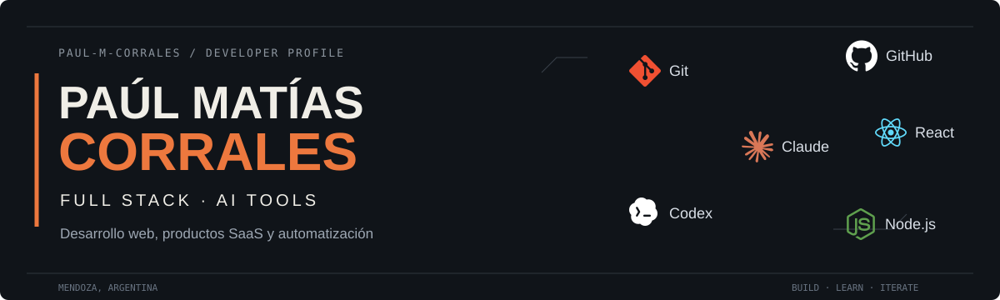
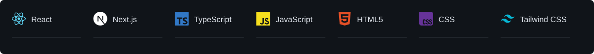
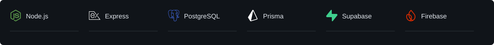
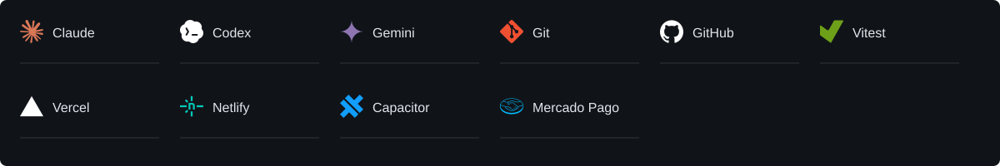
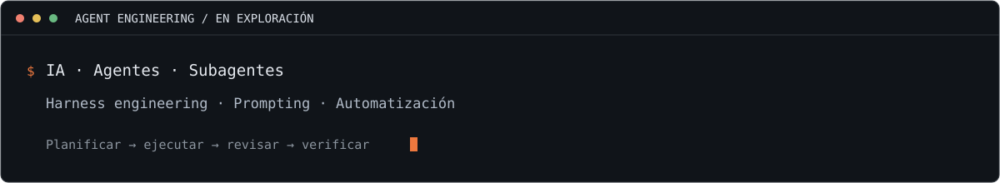

  <a href="https://www.linkedin.com/in/pa%C3%BAl-corrales-90957b237/">LinkedIn</a> ·
  <a href="https://gremoliche.com">Gremoliche</a> ·
  <a href="https://github.com/Paul-M-Corrales/ai-skills-PMC">PMC</a>

## Hola, soy Paúl 👋

Soy desarrollador Full Stack de Mendoza, Argentina. Creo aplicaciones web, productos SaaS y automatizaciones para resolver problemas concretos de personas y negocios.

Mi camino en tecnología nace de casi dos décadas de experiencia en una empresa familiar de servicios de rectificación de motores. Conozco de cerca lo que implica atender clientes, organizar trabajos y gestionar un negocio; hoy llevo esa experiencia al software que construyo.

Trabajo con JavaScript, TypeScript, React, Next.js, Node.js y PostgreSQL. Entre mis proyectos están **Gremoliche**, una plataforma de gestión para negocios; **Doy-Fe**, un sistema orientado al trabajo notarial; **Selvara**, una aplicación móvil; y **On-going**, un gestor de tareas.

También desarrollo **PMC**, un proyecto de herramientas y prácticas para trabajar con IA en desarrollo de software. Exploro agentes, subagentes, harness engineering y prompting, con foco en organizar mejor el trabajo y verificar los resultados.

**Me interesa unir la experiencia de negocio con el desarrollo de software para crear herramientas que sean útiles en el trabajo de todos los días.**

## 01 / Frontend

## 02 / Backend y datos

## 03 / IA y herramientas de desarrollo

También trabajo con **AWS SES** para el envío de correos desde funciones de servidor.

## 04 / Agentes y automatización

En **PMC** exploro cómo dar contexto, instrucciones y herramientas a los agentes de desarrollo, dividir tareas y revisar sus resultados. Me interesa evaluar qué aporta cada práctica con evidencia del trabajo realizado.

## 05 / Proyectos

| Proyecto | Qué construyo |
| :--- | :--- |
| **[Gremoliche](https://gremoliche.com)** | Plataforma SaaS de gestión para negocios: clientes, presupuestos, stock, ventas y caja. |
| **[PMC](https://github.com/Paul-M-Corrales/ai-skills-PMC)** | Herramientas y prácticas para trabajar con IA en desarrollo de software. |
| **Doy-Fe** | Sistema orientado al trabajo notarial, con gestión de clientes, documentos, agenda y asistencia de IA. |
| **Selvara** | Aplicación móvil con experiencias personalizadas. |
| **On-going** | Gestor de tareas con autenticación, sincronización en tiempo real y resúmenes por correo. |

## Conectemos

Me interesa conversar sobre **desarrollo Full Stack, productos SaaS y automatización con IA**, y conocer oportunidades de colaboración y trabajo remoto.

**[Encontrame en LinkedIn](https://www.linkedin.com/in/pa%C3%BAl-corrales-90957b237/)** · **[Explorá mis repositorios](https://github.com/Paul-M-Corrales?tab=repositories)**

<!-- Los recursos gráficos son locales. Ver ASSETS.md para fuentes y mantenimiento. -->
